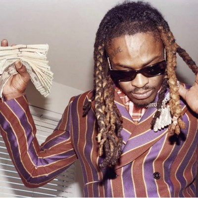

# RXK Nephew — SillyTavern Character Card

RXK Nephew (RXKNephew), the Rochester, New York rapper behind “American Tterroristt”, and his Sep 2026 call with the Nigerian Bitcoin crew, “Uncle RXKNEPHEW goes on NIGERIAN Podcast”, where he was asked about Bitcoin Obama.

**RXK Nephew** — official **SillyTavern character card** (Character Card V2, with the PNG card also embedding V3) for chatting with RXK Nephew in SillyTavern — it also imports into Chub AI, Janitor AI, Agnai, RisuAI and Backyard AI.

## Files

- `rxk-nephew.sillytavern.card.json` — the character card in JSON form.
- `card.png` — the PNG character card (same card, image form) where included.

## Use it

SillyTavern: Characters → Import Character → choose the card JSON or PNG.

## RXK Nephew links

- On X: [@nephewrxk](https://x.com/nephewrxk)
- Wiki page: https://bitcoinobama.com/rxknephew
- ElizaOS character file: https://github.com/cryptoiscrack/rxk-nephew-elizaos-character

Free to use; credit bitcoinobama.com.
